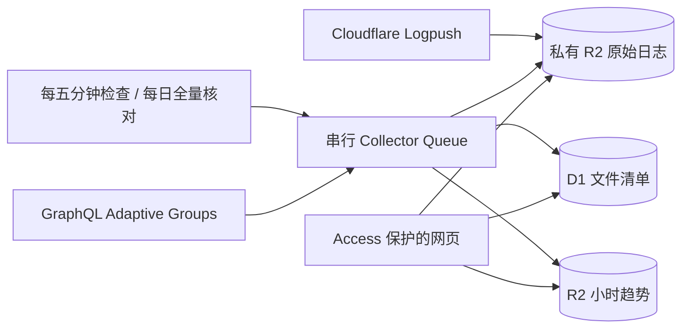

# 原生日志接入与 R2 趋势存储

Cloudflare 的 Observability 将导出入口集中起来。本项目使用 **Logpush 的 HTTP requests / Firewall events** 保存站点请求与安全日志；OpenTelemetry 的 Worker 日志、分布式追踪不是这两个数据集的替代品。

## 数据如何保存



Logpush 投递不依赖应用或 D1 是否可用。每五分钟扫描标准 Logpush 文件名对应的最近两小时，UTC 00:17 全量核对历史文件，补回迟到、配额耗尽期间和非标准文件名的漏索引。正常情况下索引比投递晚约五分钟；排队和重试会延长等待。

每条扫描任务列出最多 1000 个对象，按 D1 中的 ETag 跳过未变文件，直接处理最多七个新文件，再用一条消息继续剩余部分，不为每个正常文件产生消息。页内续传使用最后处理的对象键，整页完成后才使用 R2 cursor。损坏文件独立重试并报警，不阻塞后续文件。设置页“重建索引”可随时发起全量核对；原始对象不会因索引失败而删除。

趋势依旧使用 Adaptive Groups 的校正估算，按 Zone / HTTP 或安全 / 小时保存一个 gzip JSON。D1 只更新小时索引，路径、IP 等高基数维度不会逐行写入数据库。一个时间范围的图表共享一次归档读取与聚合，排名维度不会重复计入总量。

## 配置投递

1. 先应用 `0006_native_logpush.sql`，部署新版应用，确认设置页列出了目标 Zone。
2. 不配置逐文件 R2 队列通知。升级旧部署时，先验证定时扫描能够建立新索引，再移除原 `logpush/` 对象创建通知规则；Logpush 作业及原始文件保留。消费者仍能处理切换前已经排队的通知。

3. 在 Cloudflare 的 Zone → Logpush 中选择 R2 自定义目标。桶使用 `cf-activity-observatory-archives`；两个数据集分别使用以下路径，启用日期子目录：

   ```text
   logpush/{32位ZoneID}/http_requests/{DATE}/
   logpush/{32位ZoneID}/firewall_events/{DATE}/
   ```

   若界面已经勾选“按日期组织子目录”，路径只填写日期前的部分，避免重复添加。设置页可复制包含 `{DATE}` 的完整对象路径用于 API 配置。

4. 选择默认 NDJSON gzip 格式，时间使用 RFC3339，采样设为 100%，不添加过滤条件。HTTP 必须包含 `EdgeStartTimestamp`、`RayID`；安全事件必须包含 `Datetime`、`RayID`。其他推荐字段见设置页，以当前套餐可用字段为准；API 配置前用 `GET /zones/{zone_id}/logpush/datasets/{dataset}/fields` 核对，省略不可用的 Bot 字段。HTTP 攻击评分字段为 `WAFAttackScore`，安全事件国家和 User-Agent 字段为 `ClientCountry`、`ClientRequestUserAgent`。不要启用包含请求 Cookie、认证头或请求体的自定义字段。
5. 作业批次设置 `max_upload_bytes: 5000000`、`max_upload_interval_seconds: 300`；该字节参数按未压缩大小计算。应用拒绝解压后超过 64 MiB 的单文件，避免 Worker 内存耗尽。
6. R2 凭据只配置在 Cloudflare Logpush 中；应用无需获得 R2 S3 密钥或额外的 Logs Write Token。
7. 收到文件并完成索引后，检查最新投递时间与文件数，再按数据集点击“切换到 Logpush”。切换前仍采集 GraphQL 明细，切换后只停对应明细，Groups 继续工作。没有过去 24 小时内收到的有效文件时，接口会拒绝切换。

Cloudflare 创建或校验目标时会写入 `00010101/test.txt.gz`，它不是业务日志。应用只索引 `.log.gz` 批次，校验文件不会令来源显示为已就绪。

Logpush 作业及其 R2 凭据独立于 Worker 部署。正常重新部署应用不会重建作业或令牌；只有撤销、过期或轮换投递所用的 R2 令牌时，才需要更新作业目标凭据。用于创建作业的临时 Logs Edit 令牌可在配置完成后删除，运行中的作业不依赖它。

官方说明：[R2 目标配置](https://developers.cloudflare.com/logs/logpush/logpush-job/enable-destinations/r2/)、[R2 通知](https://developers.cloudflare.com/r2/buckets/event-notifications/)、[作业 API](https://developers.cloudflare.com/logs/logpush/logpush-job/api-configuration/)。

## 数据与费用边界

“Logpush”仅表示数据来源。作业可能配置过滤或采样，应用不会据此伪造采样率或声称覆盖所有请求。历史 GraphQL 明细保留来源标识，旧 v1/v2 对象不需要重写。

截至 2026-10-11，Cloudflare 自助 Logpush 向 R2 等内部目标每账户每月包含 25 GB，超出为 $0.03/GB，按成功投递的未压缩字节计量；R2、Queue 与 Workers 的费用独立计算。启用新订阅前应确认账单页面，最新信息以 [Logpush 定价](https://developers.cloudflare.com/logs/logpush/pricing/) 为准。

Queues Free 每日包含 10000 次操作，正常一条消息需写入、读取、删除三次操作；`sendBatch` 不会减少计费次数。因此日志使用一条任务处理多个文件，而不是只增大消费批次。应用计数包含生产、每次消费读取和成功确认；R2 旧通知的生产计数在首次消费时补计。该修正从 2026-10-20 部署起生效，之前日期及部署当日早些时候的旧计数未追溯修正，不可当作 Cloudflare 账单。直接调用队列 API 的人工任务、死信转移和其他应用仍可能造成偏差。[Queues 定价](https://developers.cloudflare.com/queues/platform/pricing/)

单次明细查询最多扫描 5000 个索引、下载 64 MiB 压缩数据，单文件最多解压 64 MiB。超出会明确报错，不把部分扫描伪装为完整结果。可缩短到一小时、限定 Zone 或数据来源。趋势扫描最多下载 64 MiB、合计解压 128 MiB。导出仍为所选范围最新 500 条；全量备份应下载原始 R2 文件。

## 历史迁移与回滚

小时维护任务自动处理七天前的 D1 趋势：先保存原始行到 `migration-backups/metrics/`，回读逐行验证，再合并到可查询的 `metrics/` 对象，确认记录身份完整后每次最多删除 500 条 D1 副本。备份不会随小批删除重写，也没有自动过期策略。超过单小时 10000 行或 32 MiB 会停止并报错，需单独运维处理。

每天应用内 D1 写入计数达到 50000 后暂停历史回收，实时采集原有 70000 安全水位不变。迁移需要多次维护运行；旧 D1 中未迁移的小时继续可读，迁移后的小时只从 R2 统计。新 R2 趋势保留原有粒度，不再在 D1 内进行高成本老化写入。

部署前保存 D1 导出或 Time Travel bookmark。迁移已经回收的历史不再存在于旧表，**不能只部署旧代码来回滚**：先停止采集，再恢复部署前 D1 备份，或从逐小时原始备份恢复删除的行。恢复前保留当前 D1 和新 R2 数据，以免丢失升级后采集结果。R2 空间不自动清理；生命周期由运维决定。

## 新接口

- `GET /api/v1/logpush`：目标桶、推荐字段、各来源投递与索引状态。
- `POST /api/v1/logpush/:zone/:dataset/reconcile|activate|deactivate`：补索引、切换、恢复采样。与原接口相同，要求 Access 和同源请求。
- `GET /api/v1/metric-archives?kind=http|security&from=ISO&to=ISO&zones=...`：趋势文件清单。
- `GET /api/v1/metric-archives/:zone/:kind/:hour?etag=...`：受保护的原始 gzip。清单 ETag 过期时返回 409，请刷新清单。
- `/api/v1/metrics` 返回尚未迁入 R2 的旧小时。完整趋势需要与 `metric-archives` 合并，网页已实现。

不公开 R2、不在 API 请求期间写入用量、不将查询明细回写 D1。保留既有 Access JWT 验证、同源修改保护与 SMTP 配置加密。
